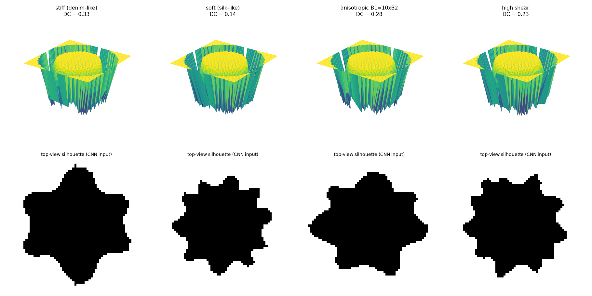
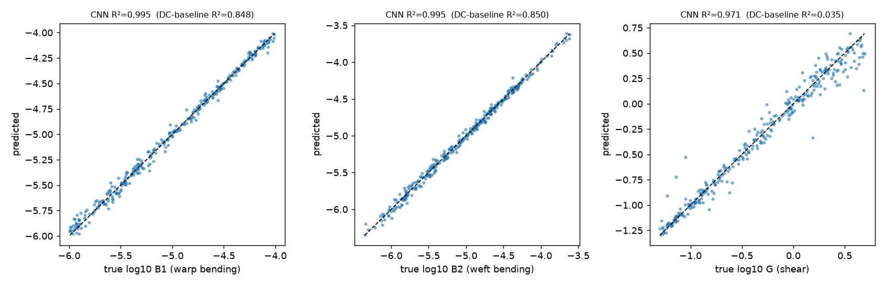
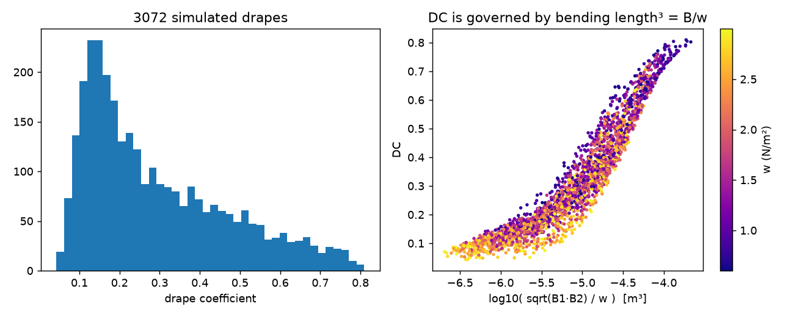

# DrapeNet — learning fabric mechanics from a drape photo

**Can a single top-view picture of a draped fabric tell us its bending and shear rigidity?**
DrapeNet builds a *virtual Cusick drape tester* (a differentiable cloth simulator written in PyTorch),
generates thousands of synthetic drapes, and solves the inverse problem two ways:

1. **Amortised inference** — a CNN maps silhouette + areal weight → (warp bending B1, weft bending B2, shear G) in milliseconds.
2. **Differentiable physics** — gradient descent *through the simulator* on the physical parameters.

Motivation: the drape coefficient (DC) is a single number used across the textile industry, but
fabric drape is governed by several properties (Kawabata KES-F). Measuring them needs expensive
instruments; a phone photo is free. This sits at the intersection of **textile mechanics, cloth
simulation and scientific machine learning** (simulation-based inference, differentiable simulation).



## Results (synthetic test set)

Test set: 308 unseen simulated fabrics (trained on 2,457, ~3 min on an Apple M4 GPU).

| Property | CNN R² | CNN median error | Baseline R² (drape coefficient + weight) |
|---|---|---|---|
| Warp bending rigidity B1 | **0.995** | ×1.05 | 0.848 |
| Weft bending rigidity B2 | **0.995** | ×1.07 | 0.850 |
| Shear rigidity G | **0.971** | ×1.09 | 0.035 |

**What this shows:** the drape coefficient gives a rough idea of bending but **no information about shear** (R² ≈ 0.04)
and can't separate warp from weft. The *shape* of the folds can. That is the main argument for
image-based drape analysis over the single-number DC.




**Differentiable-physics fit** (`fit_physics.py`, 40 Adam steps through a 600-step simulation, ~1 min on a laptop CPU):

| Start point | log10 B1 | log10 B2 | log10 G |
|---|---|---|---|
| Ground truth | −4.70 | −5.00 | −0.40 |
| Naive guess → physics fit only | −5.30 → −5.00 | −5.30 → −4.91 | −0.40 → +0.03 |
| CNN guess → physics fit (**hybrid**) | −4.76 → **−4.71** | −4.99 → **−4.99** | −0.47 → **−0.40** |

Fitting with gradients alone from a poor starting guess gets stuck in a local minimum: the fit
trades warp bending against shear. When the CNN gives the starting guess, the fit recovers all
three parameters to within 2%. This pairing (a fast learned estimate refined by physics) is the
project's main methodological point.

## How it works

| File | What it does |
|---|---|
| `drapenet/sim.py` | Batched cloth simulator: particle grid, anisotropic bending + shear energies, gravity, PBD inextensibility, pedestal collision, per-sample stable time step. Fully differentiable. Also: silhouette rendering, drape coefficient, node count. |
| `drapenet/generate.py` | Samples realistic fabrics (B 1e-6–1e-4 N·m, anisotropy ≤3×, G 0.05–5 N/m, 60–300 GSM) and simulates them. |
| `drapenet/model.py` | DrapeCNN: 4 conv blocks → GAP → concat weight → MLP → log10(B1, B2, G). |
| `drapenet/train.py` | Training, metrics, and a **DC + weight polynomial baseline** for comparison. |
| `drapenet/fit_physics.py` | Inverse fitting by back-propagating through the simulator. |
| `drapenet/predict_real.py` | Real phone photo + GSM → B1, B2, G and Peirce bending length. |
| `drapenet/visualize.py` | All figures. |
| `docs/LEARN.md` | **Step-by-step tutorial** of the theory and code (start here if you want to learn). |

Physics in one line each:
- bending energy `½·B·κ²` with κ from second finite differences (separate B for warp/weft),
- shear energy `½·G·γ²` per grid cell,
- gravity `w·z` per unit area, fabric treated as inextensible (position-based dynamics),
- forces = −∂E/∂x via autograd; damped explicit integration to static equilibrium.

## Quick start
```bash
python -m venv .venv && source .venv/bin/activate
pip install -r requirements.txt
python -m drapenet.generate --n 3072        # ~45 min on a laptop CPU (data/ is git-ignored)
python -m drapenet.train --epochs 60        # ~5-10 min (MPS/CUDA) -> checkpoints/
python -m drapenet.visualize                # figures/
python -m drapenet.fit_physics --cnn_init --iters 25 --steps 1200 --lr 0.03   # hybrid fit demo
python -m drapenet.predict_real my_drape.jpg --gsm 150 --px_per_m 2000
```
A trained checkpoint is included in `checkpoints/drapecnn.pt`.

## Real-fabric validation (in progress)
Home-made Cusick tester (18 cm plate on a stand, 30 cm specimens, phone camera above) +
cantilever bending length (ASTM D1388) as ground truth. Protocol in `docs/LEARN.md` step 7.

## CV bullets
- Built a differentiable cloth simulator in PyTorch that reproduces the Cusick drape test, with anisotropic bending, shear and inextensibility, and used it to generate 3,000+ synthetic drapes.
- Trained a CNN that predicts warp/weft bending and shear rigidity from a single drape silhouette, reaching R² = 0.97–0.995 against 0.04–0.85 for the industry drape-coefficient baseline.
- Built a hybrid inverse solver (CNN initial guess, then gradient descent through the simulator) that recovers all three properties to within 2%. Real-fabric validation with a home-built drape tester is in progress.

## Limitations
- 41×41 grid (7.5 mm spacing) — finer folds are not resolved; simplified shear model, no fabric–disc friction.
- Bending is linear-elastic (no hysteresis); real fabrics show friction-driven hysteresis (KES-B 2HB).
- Sim-to-real gap: the CNN is trained only on simulated silhouettes.

## References
- G.E. Cusick, *The measurement of fabric drape*, J. Textile Inst. 59 (1968).
- S. Kawabata, *The standardization and analysis of hand evaluation* (KES-F), 1980.
- D. Baraff, A. Witkin, *Large steps in cloth simulation*, SIGGRAPH 1998.
- M. Müller et al., *Position based dynamics*, 2007.
- J. Liang, M. Lin, V. Koltun, *Differentiable cloth simulation for inverse problems*, NeurIPS 2019.
- I. Santesteban et al., *SNUG: self-supervised neural dynamic garments*, CVPR 2022.
- A. Grigorev et al., *HOOD: hierarchical graphs for generalized modelling of clothing dynamics*, CVPR 2023.
- K. Cranmer, J. Brehmer, G. Louppe, *The frontier of simulation-based inference*, PNAS 2020.

## Author
Maulik Nehra — B.Tech Textile Engineering, IIT Delhi.  License: MIT.
